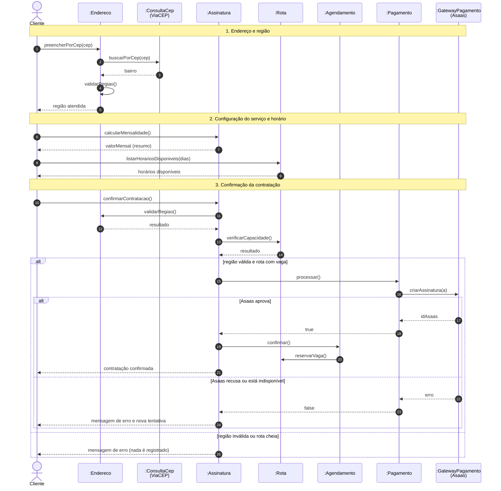
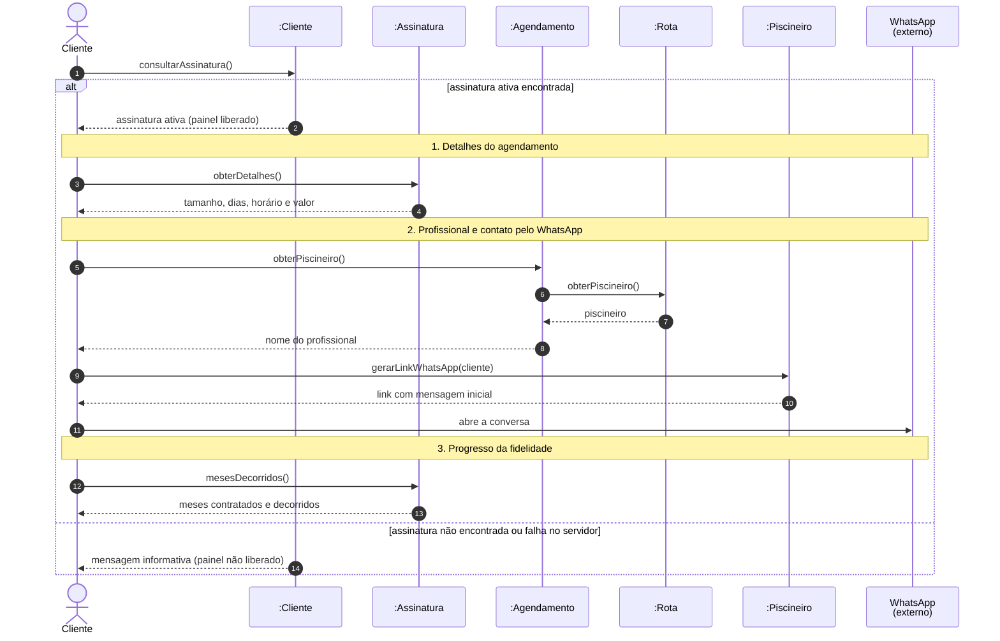
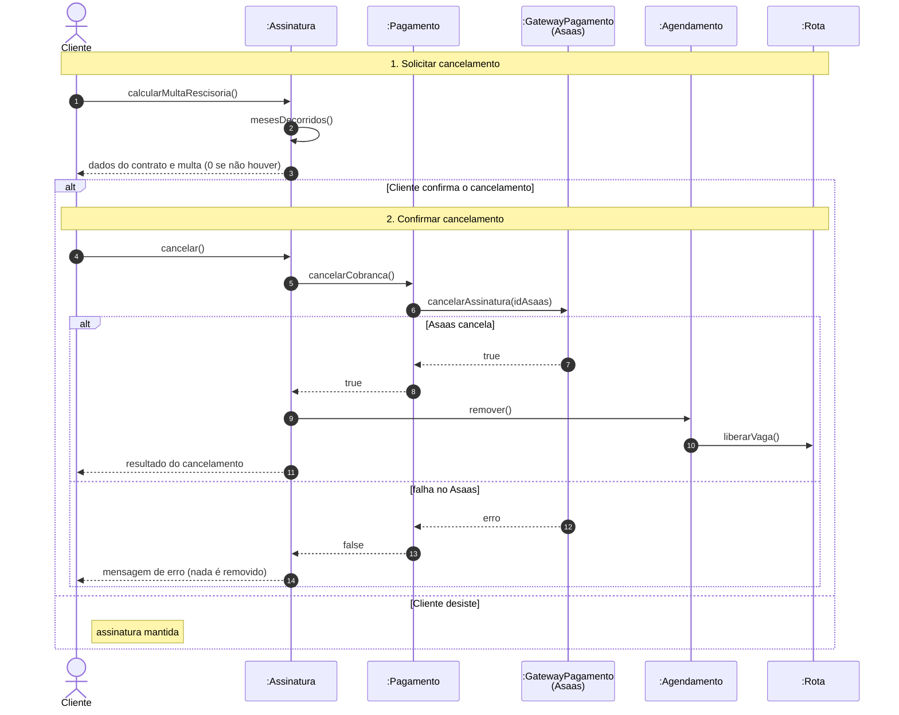
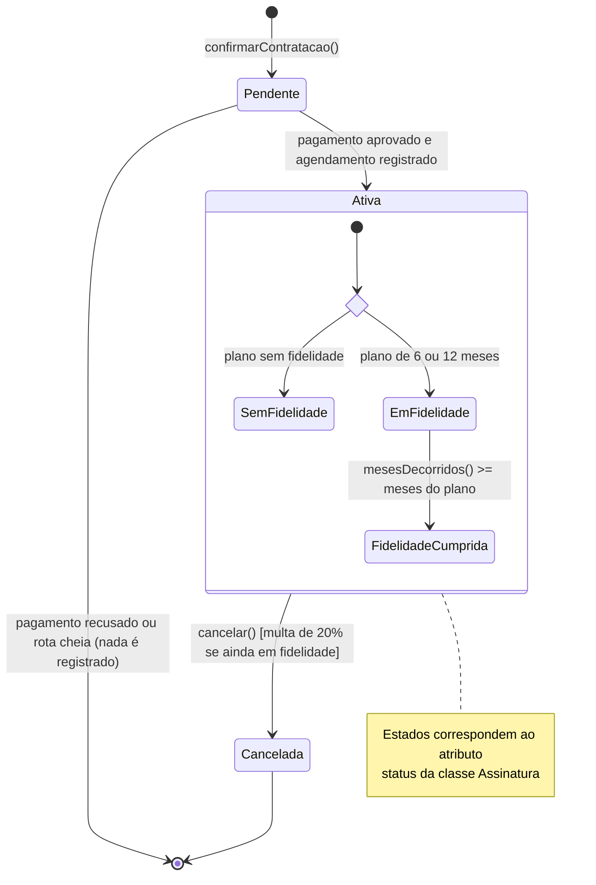
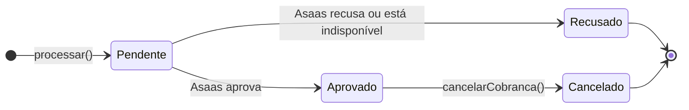
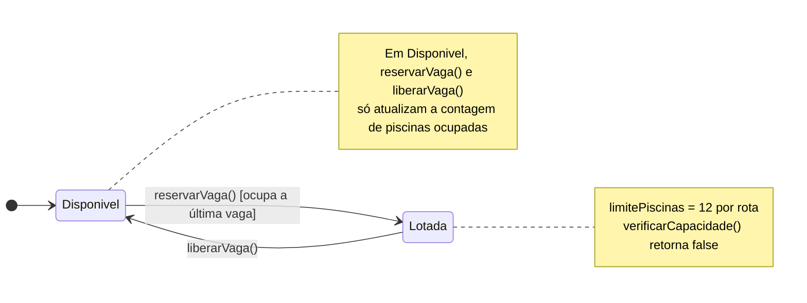

# Dossiê do Projeto: Piscineiro SaaS

**Integrantes:** Enzo, Felipe, Gustavo, João Pedro e Rennan

**Escopo:** Contratação e Área do Cliente

---

## Parte 1: Proposta do Projeto (Semana 1)

### 1.1. O Problema

Proprietários de piscinas têm dificuldade para contratar uma limpeza periódica confiável, com dia, horário e preço combinados. Já quem presta o serviço sofre para organizar rotas e cobranças recorrentes de forma previsível.

### 1.2. A Solução

O **Piscineiro SaaS** é uma plataforma para contratar a limpeza de piscina por assinatura mensal e acompanhar o contrato. Ele tem dois módulos:

* **Contratação:** cadastro, CEP e região atendida, tamanho da piscina, frequência, plano de fidelidade, horário, pagamento recorrente pelo Asaas e confirmação.
* **Área do Cliente:** consulta da assinatura, detalhes do agendamento, profissional responsável, contato por WhatsApp, progresso da fidelidade, cancelamento com multa e saída da conta.

### 1.3. Fora do Escopo desta Versão

Painel administrativo e área do técnico (rotas e faturamento), reparos avulsos, fotos dos serviços e marketplace de técnicos.

---

## Parte 2: Requisitos e Casos de Uso (Semana 2)

### 2.1. Histórias de Usuário

**Módulo Contratação**

* **HU01:** Como `cliente`, eu quero `informar meu nome completo, e-mail e número de WhatsApp` para que `eu realize meu cadastro e contrate o serviço de limpeza de piscina`.
* **HU02:** Como `cliente`, eu quero `informar meu CEP e ter meu bairro preenchido automaticamente` para que `eu facilite o cadastro do endereço e verifique as regiões atendidas`.
* **HU03:** Como `cliente`, eu quero `selecionar o tamanho da minha piscina e a frequência da limpeza` para que `eu contrate um serviço adequado às minhas necessidades`.
* **HU04:** Como `cliente`, eu quero `escolher entre os planos sem fidelidade, de 6 meses ou de 12 meses` para que `eu contrate de acordo com minha preferência e obtenha os descontos disponíveis`.
* **HU05:** Como `cliente`, eu quero `visualizar e selecionar os horários disponíveis para minha rota` para que `eu agende a limpeza da minha piscina sem conflitos de horário`.
* **HU06:** Como `cliente`, eu quero `informar os dados do meu cartão de crédito` para que `eu realize o pagamento recorrente da limpeza da minha piscina`.
* **HU07:** Como `cliente`, eu quero `visualizar um resumo do serviço contratado (tamanho, frequência, fidelidade e mensalidade)` para que `eu confira as informações antes de confirmar a contratação`.
* **HU08:** Como `cliente`, eu quero `confirmar meu agendamento e minha assinatura mensal` para que `eu contrate oficialmente o serviço de limpeza da minha piscina`.

**Módulo Área do Cliente**

* **HU01:** Como `cliente`, eu quero `consultar minha assinatura usando meu e-mail ou WhatsApp` para que `eu acesse minha área pessoal e visualize as informações do meu contrato`.
* **HU02:** Como `cliente`, eu quero `visualizar os detalhes do meu agendamento (tamanho da piscina, dias, horário e valor mensal)` para que `eu acompanhe as informações do serviço contratado`.
* **HU03:** Como `cliente`, eu quero `visualizar o profissional responsável pela limpeza da minha piscina` para que `eu saiba quem realizará o atendimento`.
* **HU04:** Como `cliente`, eu quero `entrar em contato com o profissional responsável pelo WhatsApp` para que `eu esclareça dúvidas e facilite a comunicação sobre a limpeza`.
* **HU05:** Como `cliente`, eu quero `acompanhar o progresso do meu plano de fidelidade` para que `eu saiba quantos meses já foram cumpridos e quanto falta para finalizar o contrato`.
* **HU06:** Como `cliente`, eu quero `solicitar o cancelamento da minha assinatura` para que `eu encerre a contratação do serviço quando desejar`.
* **HU07:** Como `cliente`, eu quero `confirmar o cancelamento após visualizar as condições de rescisão` para que `eu encerre meu contrato sabendo dos possíveis custos envolvidos`.
* **HU08:** Como `cliente`, eu quero `sair da minha conta` para que `eu encerre o acesso ao meu painel e volte à tela de consulta de assinatura`.

Os critérios de aceite completos estão em [`semana13/historias-de-usuario-piscineiro-saas.pdf`](semana13/historias-de-usuario-piscineiro-saas.pdf).

### 2.2. Atores

* **Cliente** (ator primário): quem contrata e acompanha a assinatura.
* **ViaCEP**, **Gateway de Pagamento Asaas** e **WhatsApp** (atores secundários, sistemas externos).

O **Piscineiro** é uma entidade do domínio (aparece para o cliente e é contatado), não um ator que opera o sistema. O Administrador está fora do escopo.

### 2.3. Diagramas de Casos de Uso (UML)

**Módulo Contratação**

**Módulo Área do Cliente**

### 2.4. Descrição Textual dos 2 Casos de Uso Mais Importantes

A descrição completa dos 15 casos de uso está em [`semana2/descricao-textual-casos-de-uso.md`](semana2/descricao-textual-casos-de-uso.md).

#### Caso de Uso 1: Confirmar Contratação (UC07)

* **Atores:** Cliente e Gateway de Pagamento Asaas
* **Pré-condições:** todas as etapas anteriores (cadastro, endereço, serviço, horário, pagamento e resumo) foram concluídas.
* **Pós-condições:** a assinatura está ativa, o agendamento está registrado e a vaga da rota está ocupada.

**Fluxo Principal:**

1. O Cliente confirma o agendamento e a assinatura.
2. O Sistema verifica o preenchimento dos campos obrigatórios.
3. O Sistema valida o CEP e as restrições geográficas.
4. O Sistema verifica a disponibilidade do horário e a capacidade da rota.
5. O Sistema calcula o valor mensal.
6. O Sistema cria a assinatura recorrente no Asaas.
7. O Sistema registra o agendamento no banco de dados.
8. O Sistema exibe a mensagem de sucesso com os dados do agendamento.

**Fluxo Alternativo:** FA1 (passo 1): o Cliente desiste antes de confirmar; nada é registrado.

**Fluxos de Exceção:**

* **FE1 (passos 2 e 3):** dado ausente ou inválido; o Sistema exibe mensagem e leva o Cliente à etapa correspondente.
* **FE2 (passo 4):** horário ocupado ou rota cheia; o Sistema informa e o Cliente escolhe outro horário.
* **FE3 (passo 6):** o Asaas recusa ou está indisponível; o Sistema exibe mensagem informativa, não registra o agendamento e permite nova tentativa.

#### Caso de Uso 2: Confirmar Cancelamento (UC14)

* **Atores:** Cliente e Gateway de Pagamento Asaas
* **Pré-condições:** a janela com as condições de rescisão está aberta (UC13 Solicitar Cancelamento de Assinatura).
* **Pós-condições:** a assinatura está cancelada, o agendamento removido e o horário e a vaga da rota liberados.

**Fluxo Principal:**

1. O Cliente confirma o cancelamento final.
2. O Sistema calcula a multa de 20% sobre o saldo restante da fidelidade.
3. O Sistema cancela a assinatura no Asaas.
4. O Sistema remove o registro do agendamento do banco de dados.
5. O Sistema libera o horário e a vaga da rota.
6. O Sistema exibe a mensagem com o resultado do cancelamento.

**Fluxos Alternativos:**

* **FA1 (passo 2):** não há fidelidade ou ela já foi cumprida; a multa é zero.
* **FA2 (passo 3):** não existe assinatura válida no gateway; o Sistema pula o cancelamento no Asaas e segue.
* **FA3 (passo 1):** o Cliente desiste; a assinatura é mantida.

**Fluxos de Exceção:** **FE1 (passo 3):** falha no Asaas; o Sistema exibe mensagem de erro, não remove nada e permite nova tentativa.

---

## Parte 3: Diagrama de Classes (Semana 3)

### 3.1. Estrutura e Encapsulamento

Todos os **atributos são privados (`-`)** para proteger os dados, e os **métodos são públicos (`+`)** para permitir a comunicação entre as classes.

### 3.2. Classes

| Classe | Responsabilidade |
|---|---|
| `Usuario` | Dados de contato de qualquer pessoa do sistema (classe base). |
| `Cliente` | Quem contrata; herda de `Usuario` e consulta a própria assinatura. |
| `Piscineiro` | Profissional responsável pela rota; herda de `Usuario` e gera o link de WhatsApp. |
| `Endereco` | CEP, bairro e região; preenche o bairro pelo ViaCEP e valida a região atendida. |
| `Piscina` | Tamanho da piscina (pequena, média ou grande). |
| `PlanoFidelidade` | Duração do plano (sem fidelidade, 6 ou 12 meses) e desconto aplicado. |
| `Assinatura` | Contrato mensal: calcula a mensalidade, confirma a contratação, mede a fidelidade e calcula a multa. |
| `Agendamento` | Dias e horário do atendimento; ocupa e libera a vaga da rota. |
| `Rota` | Agrupa os atendimentos; controla horários, intervalo mínimo de 40 minutos e limite de 12 piscinas. |
| `Pagamento` | Cobrança da assinatura; processa e cancela a cobrança pelo gateway. |
| `ConsultaCep` (interface) | Contrato de consulta ao ViaCEP. |
| `GatewayPagamento` (interface) | Contrato de integração com o Asaas. |

### 3.3. Relacionamentos e Multiplicidade

* **Herança:** `Cliente` e `Piscineiro` herdam de `Usuario`, aproveitando nome, e-mail e WhatsApp.
* **Cliente (1) possui Endereço (1).**
* **Cliente (1) contrata Assinatura (0..\*).**
* **Assinatura (0..\*) segue PlanoFidelidade (1).**
* **Assinatura (1) atende Piscina (1).**
* **Assinatura (1) gera Agendamento (0..1).**
* **Assinatura (1) é cobrada por Pagamento (0..\*).**
* **Agendamento (0..\*) ocupa vaga em Rota (1).**
* **Rota (1..\*) é atendida por Piscineiro (1).**
* **Dependências:** `Endereco` usa `ConsultaCep` e `Pagamento` usa `GatewayPagamento`.

---

## Parte 4: Sequência e Estados (Semana 4)

Os diagramas abaixo foram escritos em **Mermaid**. O código-fonte está nas pastas [`semana3/mermaid/`](semana3/mermaid/) e [`semana11/mermaid/`](semana11/mermaid/) e pode ser colado em [mermaid.live](https://mermaid.live) para visualizar e editar. As imagens renderizadas estão nas pastas `semana3/` e `semana11/`.

### 4.1. Diagramas de Sequência

As lifelines usam as mesmas classes do diagrama de classes, e as mensagens são os métodos definidos nelas.

#### 4.1.1. Caso de Uso: Contratar Limpeza de Piscina (UC01 a UC07)

Mostra o fluxo completo: preenchimento do CEP com consulta ao ViaCEP, configuração do serviço, escolha de horário e confirmação, com os caminhos de erro (região inválida, rota cheia e pagamento recusado pelo Asaas).

#### 4.1.2. Caso de Uso: Área do Cliente (UC08 a UC12)

Mostra a consulta da assinatura, os detalhes do agendamento, a busca do profissional responsável, o contato pelo WhatsApp e o progresso da fidelidade.

#### 4.1.3. Caso de Uso: Cancelar Assinatura (UC13 e UC14)

Mostra o cálculo da multa de rescisão, a confirmação do cancelamento, o cancelamento da cobrança no Asaas e a liberação da vaga da rota, incluindo a desistência do cliente e a falha no gateway.

### 4.2. Diagramas de Estados

#### 4.2.1. Classe `Assinatura`

A `Assinatura` é o objeto central do sistema. Os estados correspondem ao atributo `status`:

* **Pendente:** estado inicial, quando o cliente confirma a contratação e o sistema ainda espera a resposta do Asaas e o registro do agendamento.
* **Ativa:** pagamento aprovado e agendamento registrado. Tem três subestados: **SemFidelidade** (plano sem fidelidade), **EmFidelidade** (planos de 6 ou 12 meses em andamento) e **FidelidadeCumprida** (quando os meses decorridos alcançam os meses do plano).
* **Cancelada:** estado final, após `cancelar()`. A multa de 20% só se aplica enquanto a assinatura está em fidelidade.
* Se o pagamento for recusado ou a rota estiver cheia, nada é registrado e a assinatura nem chega a existir.

#### 4.2.2. Classe `Pagamento`

O pagamento passa de **Pendente** para **Aprovado** ou **Recusado**, conforme a resposta do Asaas. Um pagamento aprovado pode ser **Cancelado** quando a assinatura é encerrada (`cancelarCobranca()`).

#### 4.2.3. Classe `Rota`

A rota alterna entre **Disponivel** e **Lotada**. Ela fica lotada quando `reservarVaga()` ocupa a última vaga (limite de 12 piscinas) e volta a ficar disponível com `liberarVaga()`, por exemplo no cancelamento de uma assinatura.

---

## Parte 5: Visão Arquitetural: Componentes (Semana 14)

### 5.1. Componentes da Contratação

A página de contratação (HTML, CSS e JavaScript) reúne os componentes de layout, formulário de agendamento, resumo do preço e integração com pagamento. Ela conversa por HTTPS com a API Backend, que usa os serviços de Agendamentos e de Pagamentos, e se integra ao gateway de pagamento, ao WhatsApp e ao banco de dados.

### 5.2. Componentes da Área do Cliente

O painel do cliente chama a API Backend por REST/HTTPS. A API usa os serviços de Autenticação, Assinaturas, Agendamentos, Fidelidade e Cancelamentos, todos ligados ao banco de dados, e um adaptador de integração com o WhatsApp.

---

## Parte 6: Pontos para Alinhar

**Diferenças entre a documentação e o código analisado** (registradas no documento de histórias de usuário):

* **Pagamento:** a tela solicita os dados do cartão, mas a implementação usa um token simulado; o fluxo não comprova processamento real do cartão.
* **WhatsApp na contratação:** a confirmação registra uma mensagem no console do servidor, sem envio real pelo WhatsApp.
* **Consulta da Área do Cliente:** a interface chama a rota `/api/cliente-info`, que não foi localizada no `server.js` analisado.
* **Profissional atribuído:** a interface espera dados do profissional, mas esses campos não aparecem na tabela `agendamentos` analisada.

**Diferenças entre os diagramas de componentes e o restante do projeto:**

* O diagrama de Contratação cita "Stripe, Mercado Pago" como exemplo de gateway, mas o projeto usa o **Asaas**, e não mostra a consulta ao **ViaCEP**.
* O diagrama da Área do Cliente fala em "progresso/pontos" de fidelidade, mas a fidelidade do projeto é medida em meses.

**Escopo:** o painel administrativo e a área do técnico não fazem parte desta versão. Os diagramas de estados antigos (um "Pedido" com etapas como "Em Limpeza" e "Aguardando Avaliação") foram movidos para `_arquivo-antigo/semana11/`, porque não correspondem ao modelo atual de assinatura.
